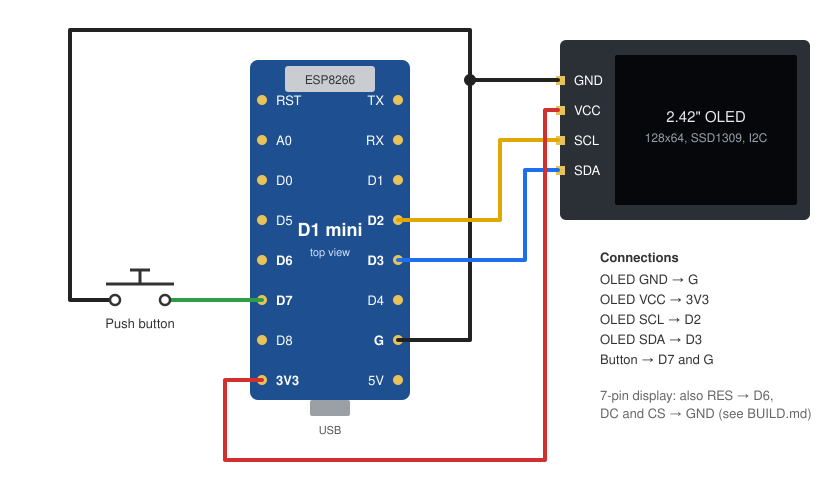

# Building the OLED Weather Station

It's a small build: a D1 mini, a 2.42" OLED, one push button and a few wires. Allow an hour or two,
most of it installing the Arduino software the first time.

## Parts

| Part | Notes | Approx. cost |
|---|---|---|
| WeMos / LOLIN **D1 mini** (ESP8266) | Any D1 mini clone works. Get one with headers, or solder them on. | $3–6 |
| **2.42" 128x64 OLED, SSD1309**, I2C | Search for "2.42 OLED SSD1309 I2C". The **4-pin I2C** version (GND, VCC, SCL, SDA) is easiest. Any single color works (white, blue, yellow, green); avoid "yellow/blue" two-color panels. | $10–20 |
| Momentary **push button** | Any small normally-open button. A panel-mount one is handy for a case. | $1 |
| **Wires** | 6 short wires (Dupont jumpers or hookup wire). | — |
| **USB cable** and a phone charger | Micro-USB or USB-C, whichever your D1 mini has. The cable must carry data for the first upload; charge-only cables won't work. | — |
| Case | A 3D-printed case is coming to this repo. A small project box works too. | — |

## Wiring

All signals are 3.3 V. Power the display from the D1 mini's **3V3** pin.

| From | To | Wire |
|---|---|---|
| OLED **GND** | D1 mini **G** | black |
| OLED **VCC** | D1 mini **3V3** | red |
| OLED **SCL** (sometimes labelled SCK) | D1 mini **D2** | yellow |
| OLED **SDA** | D1 mini **D3** | blue |
| Button, one leg | D1 mini **D7** | green |
| Button, other leg | D1 mini **G** | black |

The button needs no resistor; the sketch turns on the D1 mini's internal pull-up.

### If your display has 7 pins

The 7-pin 2.42" modules (GND, VCC, SCK, SDA, RES, DC, CS) usually ship set up for SPI and have to be
switched to I2C first:

1. On the back, move the resistor as the labels there describe for I2C mode (on most of these boards:
   move **R4 to R3** and bridge **R5** with solder). Check the silkscreen on your board before you start.
2. Connect **DC** and **CS** to **GND** (DC low gives I2C address 0x3C, which the sketch uses).
3. Connect **RES** to D1 mini **D6**. The sketch pulses D6 at startup to reset the display.
4. Wire GND, VCC, SCK (= SCL) and SDA as in the table above.

The 4-pin version doesn't need any of this; it resets itself, and D6 stays unused.

## Software

### 1. Arduino IDE and the ESP8266 boards

1. Install the [Arduino IDE](https://www.arduino.cc/en/software).
2. In **File → Preferences → Additional Boards Manager URLs**, add
   `https://arduino.esp8266.com/stable/package_esp8266com_index.json`
3. In **Tools → Board → Boards Manager**, install **esp8266**. This sketch was built with version 2.7.4.

### 2. Libraries

Install these with **Sketch → Include Library → Manage Libraries** (or from their GitHub pages):

| Library | Version used |
|---|---|
| ESP8266 and ESP32 OLED driver for SSD1306 displays (ThingPulse) | 4.1 |
| WiFiManager (tzapu) | 2.0 |
| ArduinoJson (Benoit Blanchon) | **5.13** (version 6 and later won't compile this sketch) |
| Json Streaming Parser (Daniel Eichhorn / squix78) | 1.0.5 |
| Polymorphic Buttons (JC Wentzel, `PMButton.h`) | 1.0.3 |

### 3. Upload

1. Download this repository (**Code → Download ZIP**) and unzip it. The folder must be named
   `OLED-Weather-Station-2026`, the same as the `.ino` file inside; rename it if needed.
2. Open `OLED-Weather-Station-2026.ino`.
3. Under **Tools**, choose:
   - **Board:** LOLIN(WEMOS) D1 R2 & mini
   - **Flash Size:** 4MB (FS: 2MB, OTA: ~1019KB). It needs a file system for its settings.
   - **Port:** the D1 mini's USB port
4. Click **Upload**.

Later updates can go over Wi-Fi: once the station is on your network, pick the **oled-weather** network
port under **Tools → Port**.

## First start

1. Power it up. The screen says to connect a phone to the **OLED-Weather** Wi-Fi hotspot.
2. On the page that opens (or at `192.168.4.1`), choose your Wi-Fi network, enter its password and type
   your town. The station restarts, joins your network and shows the weather.
3. For everything else, open the settings page at `http://oled-weather.local`. If that address doesn't
   work on your phone or computer, press the button: the info screen shows the station's IP address.

See the [README](README.md) for what the button does and what the settings page offers.

## Troubleshooting

| Problem | What to check |
|---|---|
| Screen stays dark | Wiring of VCC/GND, SDA/SCL swapped, display really SSD1309/SSD1306 at address 0x3C. For a 7-pin display: RES to D6, DC and CS to GND, resistors moved for I2C. |
| Screen blank or scrambled after power-up (4-pin display) | Unplug it and plug it back in. Some displays need a moment longer to start than the board. |
| Upload fails, no port shows up | Use a USB cable that carries data. Some D1 mini clones need the CH340 USB driver on Windows/macOS. |
| The OLED-Weather hotspot never appears | It only appears when the saved Wi-Fi network can't be reached. Hold the button for 2 s, then hold again to open it. |
| Wrong town or time | Search for the town again on the settings page. The time zone follows the town. |
| Start over completely | Hold the button while plugging it in, keep holding for 5 s: factory reset. |
